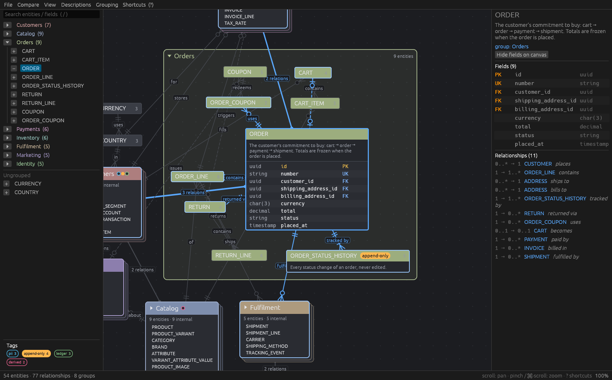
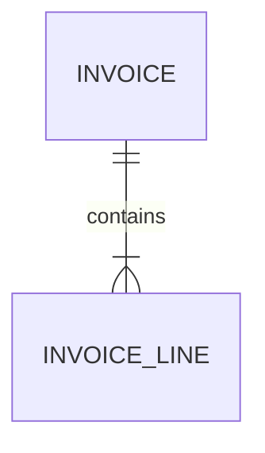
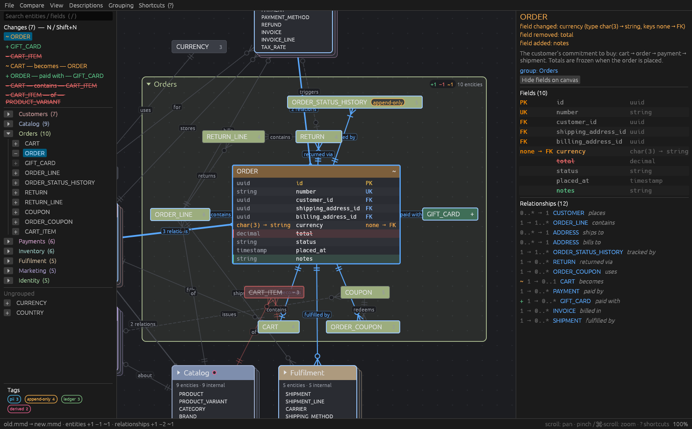

<!-- PROJECT LOGO -->
<br />
<div align="center">
  <a href="https://github.com/smartnuance/er-nuance">
    
  </a>

  <h3 align="center">ER Nuance</h3>

  <p align="center">
    Navigate and diff large Mermaid ER diagrams
    <br />
    <br />
    <a href="#install"><strong>Install</strong></a>
    ·
    <a href="#diff-mode">Diff mode</a>
    ·
    <a href="https://github.com/smartnuance/er-nuance/issues">Report a bug</a>
  </p>
</div>



A desktop viewer for navigating large ER diagrams written in Mermaid `erDiagram` syntax.
Built with Rust + egui/eframe 0.36.

It opens on a high-level view: groups are shown as stacked boxes listing their entities, and
entities show only their names. Relationships attach to whatever is visible. A relationship to
an entity inside a collapsed group is drawn to the group box, and several relationships between
the same two boxes become one line labelled "n relations" (hover to see each one). Expanding a
group reveals its entities in place, and the boxes around it move aside. Collapsing the group
puts them back.

```sh
ernuance path/to/schema.mmd   # or .md with ```mermaid blocks
ernuance                      # then File → Open, drag & drop, or "Load example"
```

## Install

**Prebuilt binaries** (macOS, Linux, Windows) are attached to each
[release](https://github.com/smartnuance/er-nuance/releases). Or use the installer:

```sh
# macOS / Linux
curl --proto '=https' --tlsv1.2 -LsSf https://github.com/smartnuance/er-nuance/releases/latest/download/er-nuance-installer.sh | sh
```

```powershell
# Windows
powershell -ExecutionPolicy Bypass -c "irm https://github.com/smartnuance/er-nuance/releases/latest/download/er-nuance-installer.ps1 | iex"
```

**From source** with Rust 1.85 or newer:

```sh
cargo install --git https://github.com/smartnuance/er-nuance --locked
```

On Linux, building needs a C compiler and the windowing libraries, e.g. on Debian/Ubuntu:

```sh
sudo apt install build-essential libxkbcommon-dev libwayland-dev libx11-dev libxcursor-dev libxrandr-dev libxi-dev libgl1-mesa-dev
```

No `git` binary, libgit2 or GTK is needed at runtime.

On macOS the menus live in the system menu bar; elsewhere they are drawn in the window.

The file is reloaded automatically when it changes. The positions and open/closed state are
saved next to it as `<file>.layout.json`.

## Groups

Mermaid has no grouping syntax, so groups are declared in comments. Mermaid ignores these lines, so
the file still renders anywhere else:



Entities can carry a description the same way. Write one line per paragraph. `*italic*`,
`**strong**` and `` `code` `` are rendered:

```
%% describe INVOICE: What the customer is billed. Re-issued, never edited.
```

Descriptions always appear in the hover tooltip and the details panel. Press **D** (or use the
Descriptions menu) to also show them inside the entity boxes. They are hidden automatically
below about 50% zoom, so the overview stays clean.

`#TAG` words in a describe line become tags (letters, digits, `_` and `-`; `C#` or `#3` are
not tags). They are taken out of the text and shown as colored chips after the entity name;
collapsed groups show one dot per tag among their members:

```
%% describe SUBSCRIPTION: #CONSUMER A consumer of the event log.
```

All tags are listed at the bottom of the left panel. Click a tag to highlight it (its chips are
filled in), double-click it to expand only the groups that contain it. Searching for `#name` finds
tagged entities.

When fields are shown, an attribute comment that is an option list (`string status "open | done |
dismissed"`) is printed under the attribute's type. Other comments appear when you hover the field.

If a file has no group lines, it is grouped automatically by relationship clusters (Louvain).
The **Grouping** menu switches between *from file*, *by name prefix* (`billing_invoice`,
`BillingInvoice`), *by clusters*, and *none*.

## Diff mode



Shows what changed between two versions of a diagram, on one merged canvas. Added entities,
fields and relationships are green, removed ones red (faded, struck through), changed ones amber.
A changed field shows `old → new` inline, and collapsed groups carry a `+2 −1 ~3` badge. The
left panel lists every change; **N** / **Shift+N** jump to the next / previous one.

```sh
ernuance diff old.mmd new.mmd              # two files
ernuance diff schema.mmd                   # HEAD → working tree (updates live as you edit)
ernuance diff schema.mmd main              # main → working tree
ernuance diff schema.mmd main..feature     # two commits
ernuance diff schema.mmd --staged          # HEAD → index
```

The comparison is structural: entities match by id, fields by name, relationships by their two
entities and label. Reordering, whitespace and comments make no difference, and a renamed entity
shows as removed + added. git is read through [gitoxide](https://github.com/GitoxideLabs/gitoxide),
so no `git` binary is needed.

To use it for any git diff (branches, stashes, PR ranges), register it as a difftool once:

```sh
git config difftool.ernuance.cmd 'ernuance diff "$LOCAL" "$REMOTE"'
git difftool -t ernuance origin/main... -- schema.mmd
```

In the app, the **Compare** menu (and the command palette) offers *Compare with HEAD*, *Compare
with commit…* (the commits that touched the file) and *Compare with file…*. Diff mode uses the
file's saved layout but never writes it.

## Navigation

| Key / mouse | Action |
|---|---|
| click, Tab, arrow keys | select (arrows jump to the nearest box in that direction) |
| Space, double-click | expand / collapse a group · show / hide an entity's fields |
| Enter | expand a group and select its main entity |
| Esc | go up: entity → its group → nothing |
| C / Backspace | collapse the selected or enclosing group |
| F | toggle fields of the selection (all members, for a group) |
| Shift+F | show / hide fields everywhere (each box keeps its own state for when they come back) |
| G / Shift+G | collapse / expand all groups |
| `.` or Z, 0 | center the selection, fit everything |
| ⌘K / Ctrl+K | command palette: type ahead over commands, settings and entities; Space toggles settings, Enter runs |
| `/` or ⌘F | search entities and field names; Enter jumps to the first match |
| D | show / hide descriptions in boxes (only when zoomed in) |
| P | hide / show both side panels |
| L | re-layout from scratch |
| N / Shift+N | diff mode: next / previous change |
| drag box / background | move it (others make room) / pan |
| scroll, pinch or ⌘-scroll | pan, zoom |

Clicking a related entity in the right-hand panel jumps to it and expands its group if needed.

## Development

```sh
cargo test                               # parser, grouping, layout, scene tests
cargo test screenshots -- --ignored      # renders UI states to target/screenshots/*.png
cargo test readme_screenshots -- --ignored  # refreshes docs/screenshots/ for this README
cargo run --release -- path/to/schema.mmd
```

Releases are built by [dist](https://opensource.axo.dev/cargo-dist/) on GitHub Actions
(`.github/workflows/release.yml`): bump `version` in `Cargo.toml`, commit, then push a tag such as
`git tag v0.1.0 && git push --tags`. The workflow builds macOS (arm64, x86_64), Linux (x86_64,
arm64) and Windows binaries plus the installer scripts and publishes them as a GitHub release.
After changing `dist-workspace.toml`, run `dist generate` to update the workflow.

Code layout: `mermaid.rs` (parser) → `model.rs` → `grouping.rs` → `scene.rs` (view state,
geometry, visible edges) using `layout.rs` (box-aware force layout, overlap removal, compaction)
→ `canvas.rs` (painting) and `app.rs` (panels, input). Diff mode: `cli.rs` (arguments) and
`vcs.rs` (reading git via gix) feed `diff.rs`, which merges two parsed diagrams and marks changes.

## License

[MIT](LICENSE) © Simon Wehrli
